# JumpDesk

[](https://github.com/metin-aydin/JumpDesk/actions/workflows/ci.yml)
[](LICENSE)

A desktop client for [JumpServer](https://github.com/jumpserver/jumpserver) (v4, Community edition). It signs in
through your JumpServer's own login page and opens SSH, SFTP and RDP sessions over the same HTTPS port the web UI uses,
so it works on networks where only 443 is reachable.

> JumpDesk is an independent project and is not affiliated with the JumpServer team.

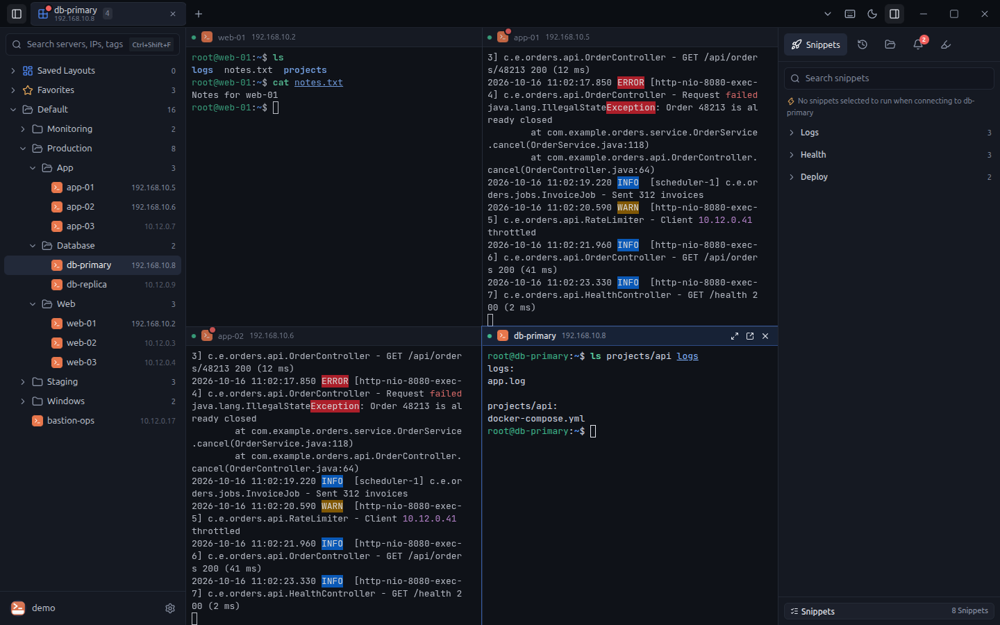

## Features

- **Server tree and search** with tags, favorites, hover cards and multi-select connect.
- **Terminal (SSH/Telnet)** built on xterm.js: split views (side by side, stacked, grid), broadcast input, tabs that
  can be dragged into separate windows and back, terminal search, keyword highlights and alarm rules with desktop
  notifications.
- **Shell integration**: command and file autocomplete, command history, colored command line, local IP detection.
- **Snippets** that run on demand or automatically on connect, saved layouts and a command palette.
- **File manager (SFTP)** with upload and download.
- **RDP** sessions through JumpServer's Guacamole gateway.
- **AI autocomplete (optional)**: ask a question in the terminal and pick a suggested command. Supports Anthropic,
  OpenAI, Google Gemini, Azure OpenAI and OpenAI-compatible servers (Ollama, LM Studio, vLLM). Only the question and the
  server type are sent; commands are written to the prompt and never run without your Enter.
- **Encrypted export/import** of snippets, rules, highlights, layouts and settings (`.jumpdesk` files).
- English and Turkish interface, light and dark themes, per-user local settings.

## Screenshots

| | |
| --- | --- |
| 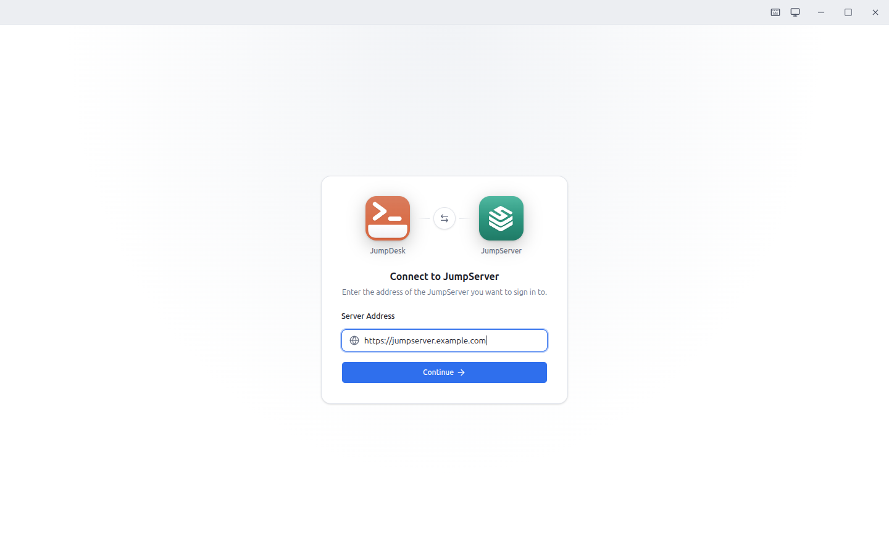 | 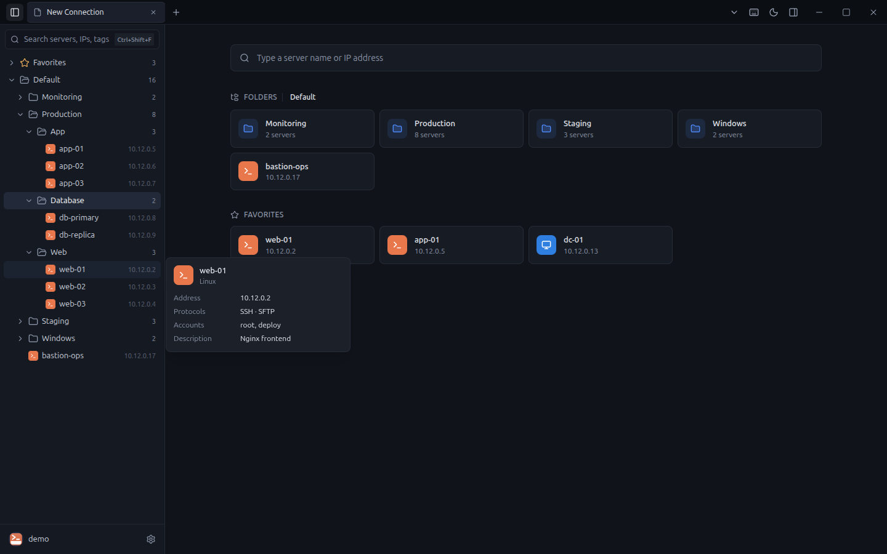 |
| **Sign in** to any JumpServer: enter its address, then use its own login page (LDAP, MFA and SSO work as usual). | **Server tree** with folders, favorites, recent connections and hover cards. |
| 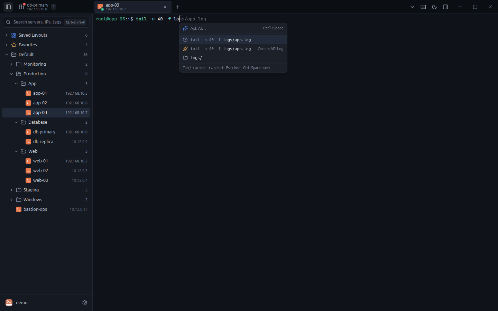 | 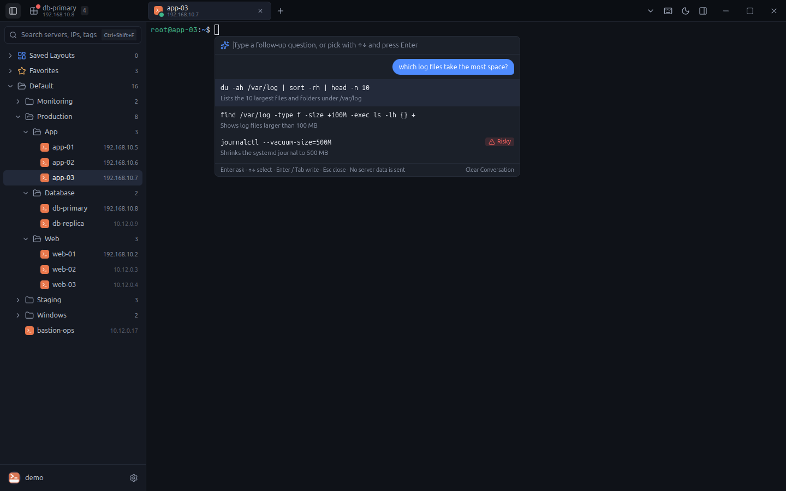 |
| **Autocomplete** from history, snippets and remote files. | **Ask AI** with Ctrl+Space twice; pick a command, it is written to the prompt and runs only on Enter. |
| 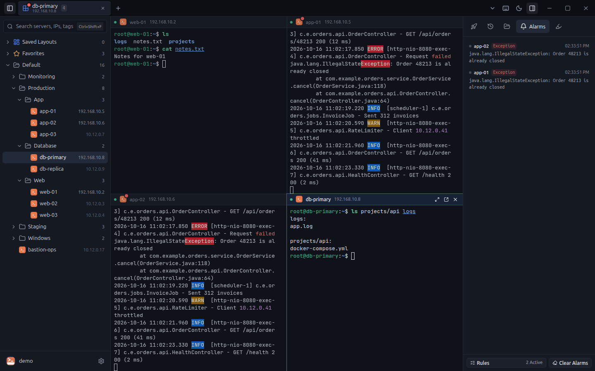 | 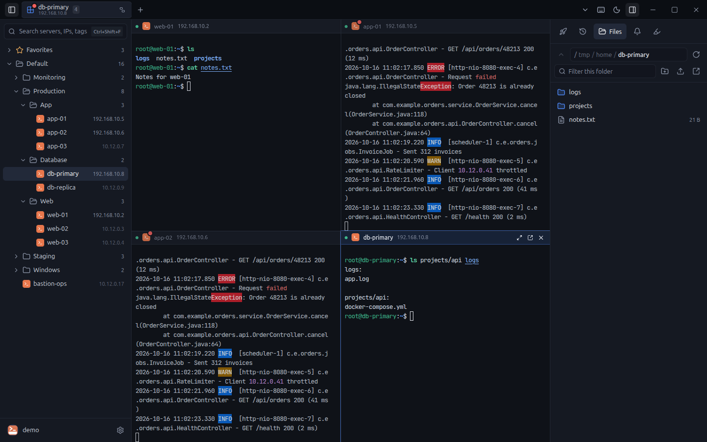 |
| **Alarm rules** catch words or regular expressions in any session and notify you. | **File manager (SFTP)** for the active session: browse, upload, download. |
| 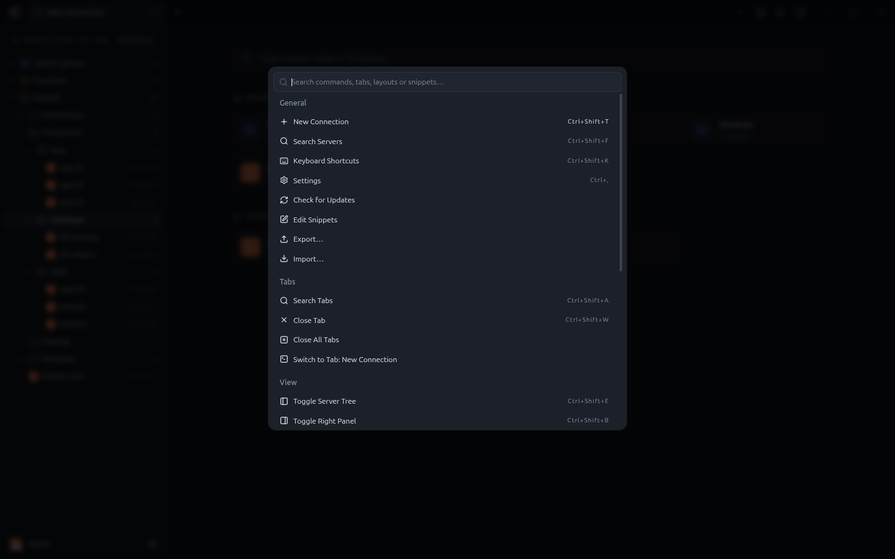 | 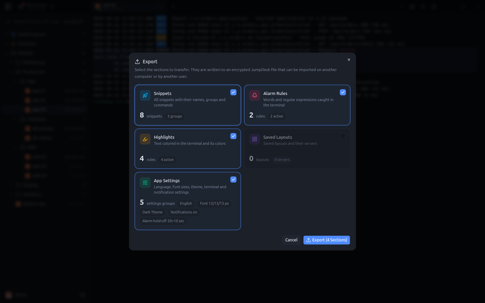 |
| **Command palette** (Ctrl+Shift+P) for every action, tab, layout and snippet. | **Encrypted export/import** of snippets, rules, highlights, layouts and settings. |
| 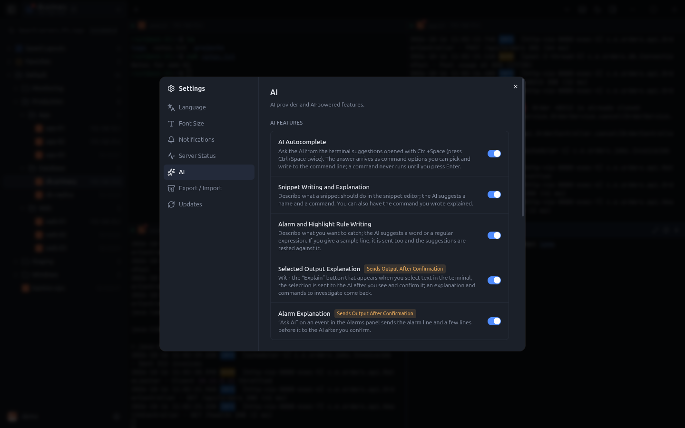 | 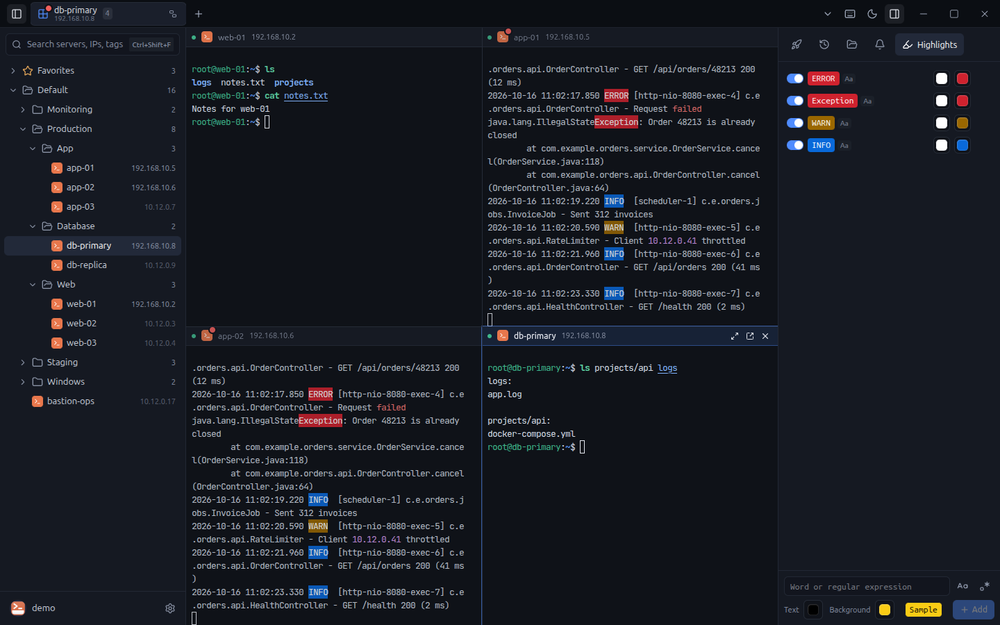 |
| **AI providers**: Anthropic, OpenAI, Gemini, Azure OpenAI or a local OpenAI-compatible server. | **Highlights** color words or regular expressions in terminal output, such as log levels. |

Screenshots are generated against the bundled mock server with `npm run build && npm run screenshots`.

## Download

Prebuilt packages (Linux AppImage and .deb, Windows portable) are published on the
[Releases](https://github.com/metin-aydin/JumpDesk/releases) page.

## Development

Requirements: Node.js 20 or newer.

```bash
git clone https://github.com/metin-aydin/JumpDesk.git
cd JumpDesk
npm install
npm run mock       # mock JumpServer on http://127.0.0.1:18080 (any username, password: demo)
npm run dev:mock   # app against the mock server
npm run dev        # app; enter your JumpServer address on the start screen
```

Checks:

```bash
npm run typecheck
node dev/i18n-check.mjs          # every UI string has an English translation
node dev/alarm-detector.test.mjs # unit tests (also ai-safety, ai-providers)
npm run build && node dev/e2e/smoke.mjs   # end-to-end tests run against the mock server
```

On Linux the app runs under XWayland (`--ozone-platform=x11`) so tabs can be dragged between windows; set
`JUMPDESK_WAYLAND=1` to use Wayland.

## Packaging

```bash
npm run build && npx electron-builder --linux       # AppImage + deb
npx electron-builder --win portable --x64            # Windows portable
```

## Issues and contributions

Bug reports and feature requests are welcome on [GitHub Issues](https://github.com/metin-aydin/JumpDesk/issues).
User-facing text is written in Turkish in the source and translated through `src/renderer/src/i18n/en/`; run
`node dev/i18n-check.mjs` before opening a pull request.

## License

[MIT](LICENSE). `swagger.json` is JumpServer's API description (GPLv3), kept for reference.
