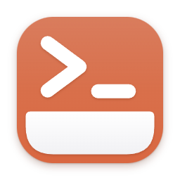

<p align="center">
  
</p>

<h1 align="center">JumpDesk</h1>

<p align="center">
  A cross-platform desktop client for <a href="https://github.com/jumpserver/jumpserver">JumpServer</a>.
</p>

<p align="center">
  <a href="https://github.com/metin-aydin/JumpDesk/actions/workflows/ci.yml"></a>
  <a href="LICENSE"></a>
</p>

JumpDesk turns your JumpServer assets into a desktop workspace: browse the server tree, open SSH, SFTP and RDP
sessions in tabs and split views, run snippets, follow logs with highlights and alarms, and ask an AI for a command
when you need one. It works with JumpServer v4 (Community edition) on Linux and Windows.

> JumpDesk is an independent project and is not affiliated with the JumpServer team.


## Features

- **Sign in with your JumpServer's own login page** (LDAP, MFA and SSO work as usual). Sessions use the same
  HTTPS connection as the web UI, so no extra ports need to be open.
- **Server tree and search** with tags, favorites, hover cards and multi-select connect.
- **Terminal (SSH/Telnet)** built on xterm.js: split views (side by side, stacked, grid), broadcast input, tabs that
  can be dragged into separate windows and back, terminal search, keyword highlights and alarm rules with desktop
  notifications.
- **Shell integration**: command and file autocomplete, command history, colored command line, local IP detection.
- **Snippets** that run on demand or automatically on connect, saved layouts and a command palette.
- **File manager (SFTP)** with upload and download.
- **RDP** sessions through JumpServer's Guacamole gateway.
- **AI autocomplete (optional)**: ask a question in the terminal and pick a suggested command. Supports Anthropic,
  OpenAI, Google Gemini, Azure OpenAI and OpenAI-compatible servers (Ollama, LM Studio, vLLM). Only the question and the
  server type are sent; commands are written to the prompt and never run without your Enter.
- **Encrypted export/import** of snippets, rules, highlights, layouts and settings (`.jumpdesk` files).
- **In-app updates** from GitHub Releases for the AppImage, .deb and Windows installer builds.
- English and Turkish interface, light and dark themes, per-user local settings.

## Screenshots

| | |
| --- | --- |
|  |  |
| **Sign in** to any JumpServer: enter its address, then use its own login page (LDAP, MFA and SSO work as usual). | **Server tree** with folders, favorites, recent connections and hover cards. |
|  |  |
| **Autocomplete** from history, snippets and remote files. | **Ask AI** with Ctrl+Space twice; pick a command, it is written to the prompt and runs only on Enter. |
|  |  |
| **Alarm rules** catch words or regular expressions in any session and notify you. | **File manager (SFTP)** for the active session: browse, upload, download. |
|  |  |
| **Command palette** (Ctrl+Shift+P) for every action, tab, layout and snippet. | **Encrypted export/import** of snippets, rules, highlights, layouts and settings. |
|  |  |
| **AI providers**: Anthropic, OpenAI, Gemini, Azure OpenAI or a local OpenAI-compatible server. | **Highlights** color words or regular expressions in terminal output, such as log levels. |

Screenshots are generated against the bundled mock server with `npm run build && npm run screenshots`.

## Download

Get the latest version from the [Releases](https://github.com/metin-aydin/JumpDesk/releases/latest) page:

| Platform | File | Updates |
| --- | --- | --- |
| Linux | `JumpDesk-<version>.AppImage` (make it executable and run it) | In the app |
| Debian, Ubuntu | `jumpdesk_<version>_amd64.deb` | In the app (asks for your password) |
| Windows | `JumpDesk-<version>-Setup.exe` | In the app |
| Windows, no install | `JumpDesk-<version>-Portable.exe` | Download page |

JumpDesk looks for a new version shortly after startup and every six hours. When it finds one it shows a
notification; **Settings → Updates** downloads it, installs it and restarts the app. Nothing is downloaded or installed
without asking, and automatic checks can be turned off there.

## Development

Requirements: Node.js 20 or newer.

```bash
git clone https://github.com/metin-aydin/JumpDesk.git
cd JumpDesk
npm install
npm run mock       # mock JumpServer on http://127.0.0.1:18080 (any username, password: demo)
npm run dev:mock   # app against the mock server
npm run dev        # app; enter your JumpServer address on the start screen
```

Checks:

```bash
npm run typecheck
node dev/i18n-check.mjs          # every UI string has an English translation
node dev/alarm-detector.test.mjs # unit tests (also ai-safety, ai-providers)
npm run build && node dev/e2e/smoke.mjs   # end-to-end tests run against the mock server
```

On Linux the app runs under XWayland (`--ozone-platform=x11`) so tabs can be dragged between windows; set
`JUMPDESK_WAYLAND=1` to use Wayland.

## Branches and releases

- Work happens on `development`; open pull requests against it.
- Merging `development` into `main` publishes a release. The
  [Release workflow](.github/workflows/release.yml) picks the version, builds the Linux and Windows packages and
  attaches them to a new GitHub release, which the in-app updater then offers to users.
- The description of that pull request becomes the release notes (see the
  [pull request template](.github/pull_request_template.md)); if it is empty, the commit titles since the previous
  release are listed.
- Each release raises the patch number (0.2.0 → 0.2.1 → …). For a new minor or major version, set `version` in
  `package.json` on `development` (for example `0.3.0`); the next release uses it.

## Packaging

```bash
npm run build && npx electron-builder --linux       # AppImage + deb
npx electron-builder --win portable --x64            # Windows portable
```

## Issues and contributions

Bug reports and feature requests are welcome on [GitHub Issues](https://github.com/metin-aydin/JumpDesk/issues).
Pull requests go to the `development` branch.
User-facing text is written in Turkish in the source and translated through `src/renderer/src/i18n/en/`; run
`node dev/i18n-check.mjs` before opening a pull request.

## License

[MIT](LICENSE). `swagger.json` is JumpServer's API description (GPLv3), kept for reference.
